# Athlex — Boas práticas de acoplamento e coesão (G1: React Native – Consumo de API)

**Branch:** `refactor/boas-praticas`

## Integrantes
| Integrante | Papel |
|---|---|
| Ricardo Marin | Líder do Grupo |
| Artur Machado | Gestor de Projetos |
| Anderson Tavares | Analista de Requisitos |
| Geraldo Konig | Designer UX/UI |
| Vinicius Galvani | Desenvolvedor Front-end |
| Pedro Fanton | Desenvolvedor Back-end |
| Tainã Metz | Desenvolvedor Back-end |
| Lucas Zilio | Engenheiro de Qualidade |

---

## 1. Boas práticas que já aplicávamos

### 1.1 Camada de serviço (separação de responsabilidades / baixo acoplamento)
Telas não conhecem `fetch`, URL, token nem formato do backend; só chamam métodos de negócio (`api.listarProdutos`).

`HomeScreens.tsx` (tela) — só consome a API:

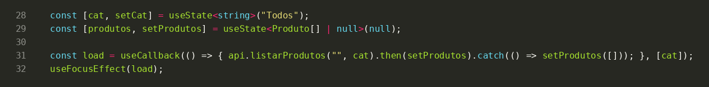

`services/api.ts` — a camada concentra a comunicação:

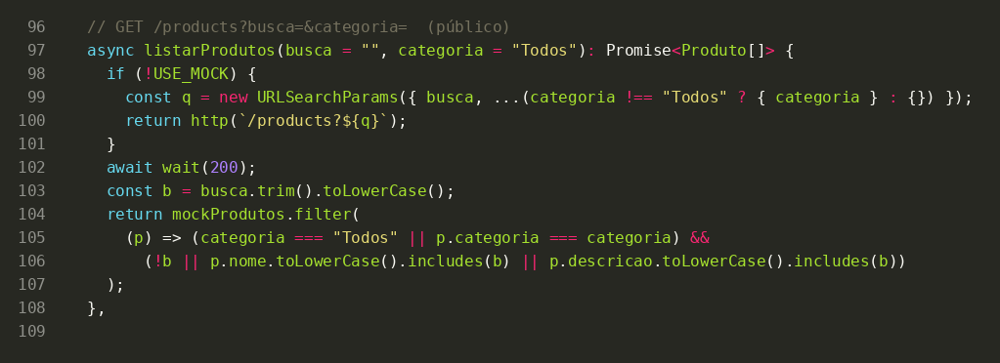

**Por que se encaixa:** a definição de camada de serviço é isolar o acesso a dados da interface. Se a URL, a autenticação ou o formato mudarem, só `api.ts` muda; as telas ficam intactas (baixo acoplamento, alta coesão da tela em torno de UI).

### 1.2 Context API / Provider (encapsulamento de estado)
O estado do carrinho e suas regras (adicionar, somar quantidade, remover, total) vivem em um único módulo, exposto por uma interface pequena (`CartCtx`) e consumido via `useCart()`.

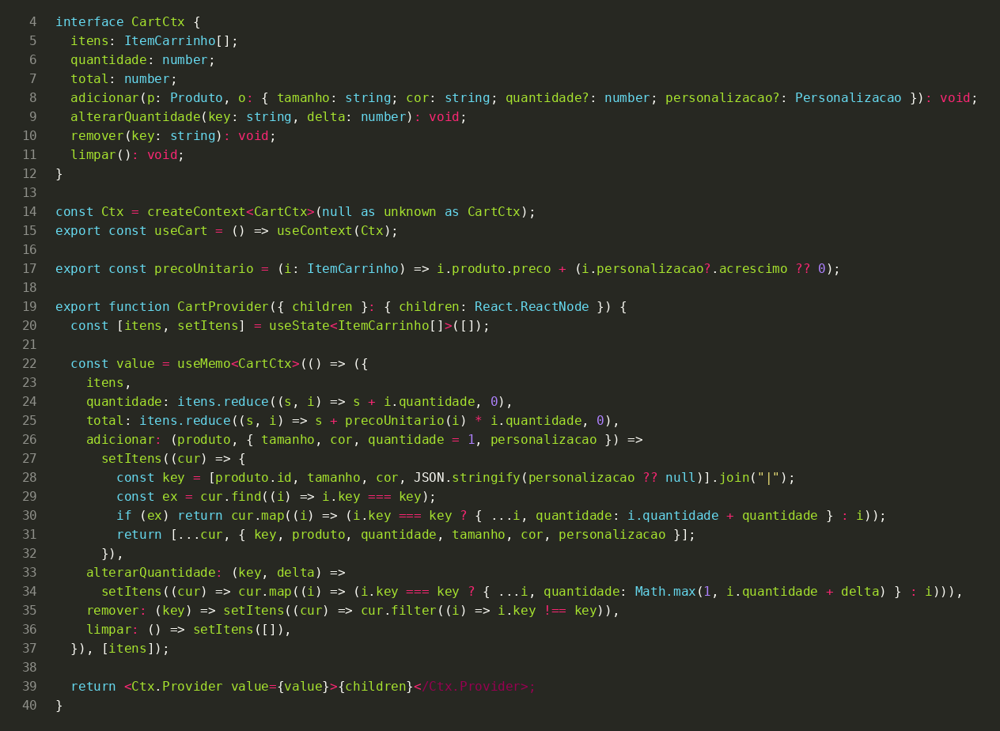

**Por que se encaixa:** encapsulamento — os consumidores dependem do contrato (`CartCtx`), não da implementação (`useState`/`useMemo`). Evita *prop drilling* (acoplamento entre telas intermediárias) e mantém a lógica do carrinho coesa em um lugar só. O mesmo padrão vale para `AuthContext` (JWT/sessão).

### 1.3 Componentes reutilizáveis (DRY / composição)
`Button`, `Input`, `Chip`, `Card` etc. foram criados uma vez e reutilizados em todas as telas.

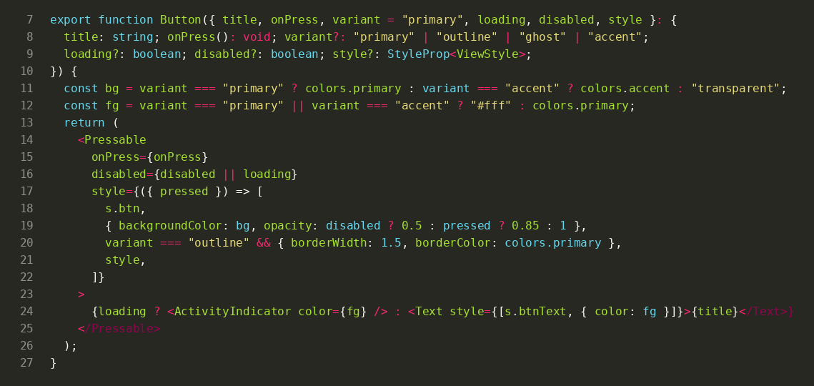

Uso na tela de login (uma linha por botão, sem repetir estilo):

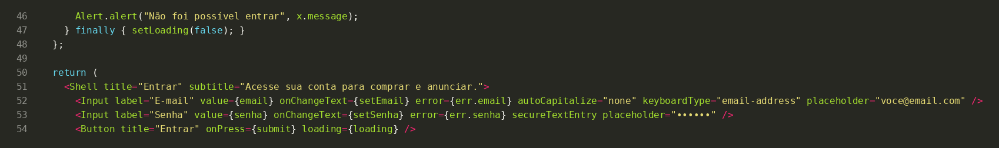

**Por que se encaixa:** DRY — a aparência/comportamento do botão (loading, disabled, variantes) está definida em um ponto; alterar o design não exige tocar em cada tela.

### 1.4 Tokens de design centralizados (fonte única da verdade)
Cores, raios, tipografia e sombra ficam em `theme.ts`.

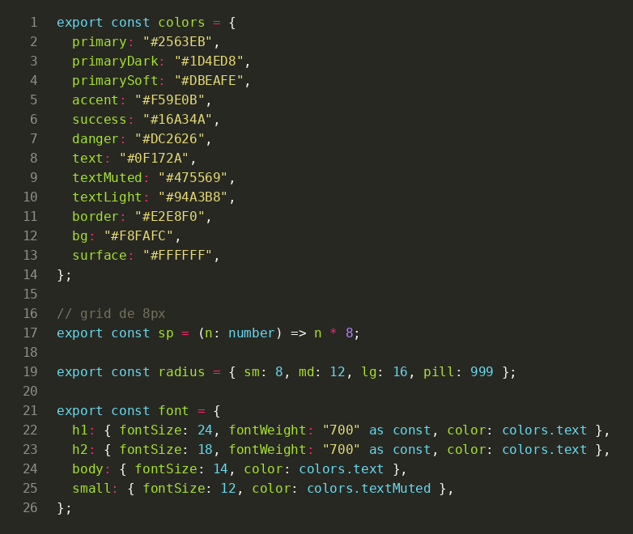

**Por que se encaixa:** *Single Source of Truth* — telas referenciam `colors.primary` em vez de repetir `#2563EB`; trocar a identidade visual é uma mudança em um arquivo.

---

## 2. Boas práticas que melhoram o código (refatorações)

### 2.1 Problema de acoplamento: telas/contextos presos à implementação concreta da API (e mock misturado ao HTTP)
**Antes** — `api.ts` era um objeto único com `if (!USE_MOCK)` dentro de cada método, misturando cliente HTTP, dados fake, decodificação de JWT e mapeamentos (também baixa coesão):

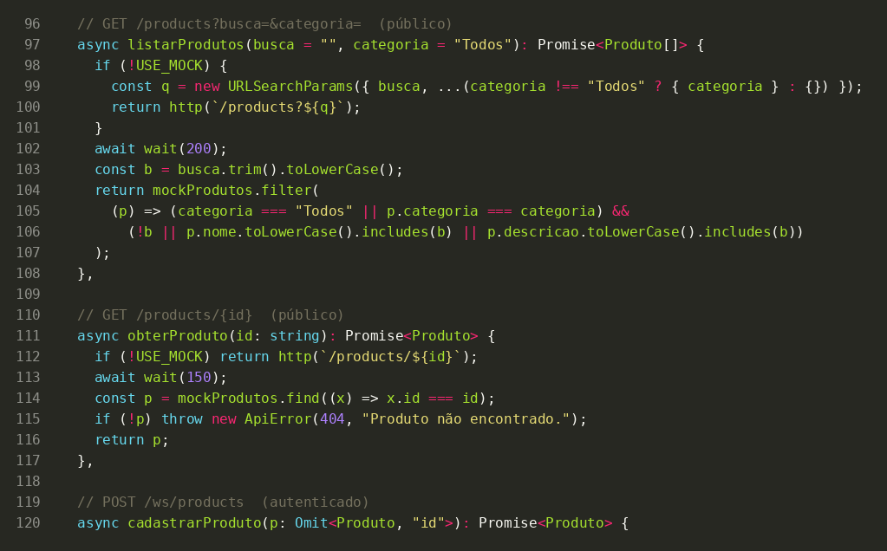

**Justificativa:** o acoplamento era alto — qualquer troca de backend/mock exigia mexer em todos os métodos; o mock "vazava" para o código de produção; não dava para testar uma implementação isolada. Viola o **Princípio da Inversão de Dependência (DIP)** e o **Aberto/Fechado**.

**Depois** — consumidores dependem de uma interface (`ApiClient`); `HttpApi` e `MockApi` a implementam; um único *composition root* escolhe qual usar:

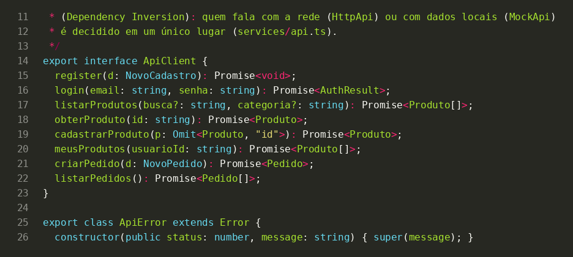

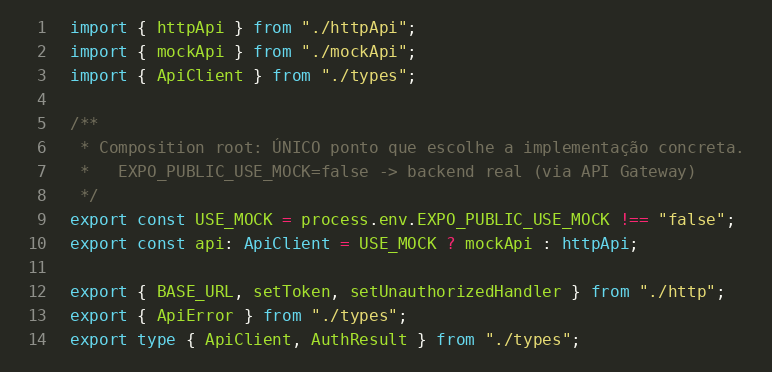

Arquivos novos: `services/types.ts` (contrato), `http.ts` (infra de rede/JWT), `httpApi.ts` (backend real via Gateway), `mockApi.ts` (dados em memória), `api.ts` (escolha da implementação). **Nenhuma tela precisou mudar a forma de chamar** (`api.login(...)` etc.). Resultado: acoplamento a abstração, não a implementação; novas fontes de dados (ex.: cache offline) entram sem alterar as telas.

### 2.2 Problema de coesão: validação, máscaras e regra de preço espalhadas e duplicadas nas telas
**Antes** — cada tela validava seus campos "no meio" do componente (e-mail, telefone, endereço, cartão), a máscara de telefone ficava dentro de `RegisterScreen`, o acréscimo de personalização era calculado em dois lugares (`PRECO_NOME`/`PRECO_NUMERO` na tela e `precoUnitario` no contexto) e componentes compartilhados (`NeedLogin`, `Stepper`) moravam dentro de uma tela e eram importados por outras:

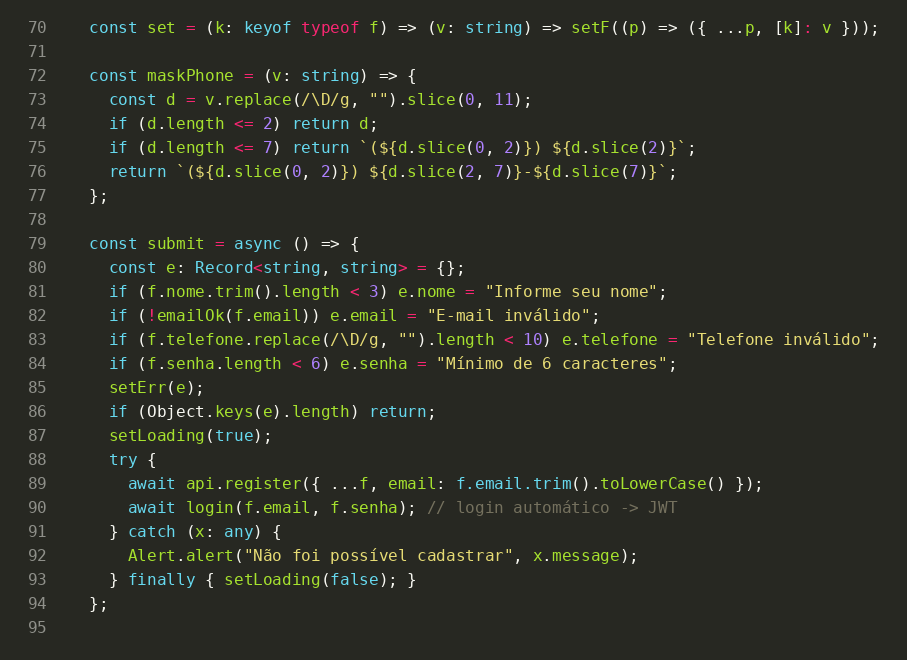

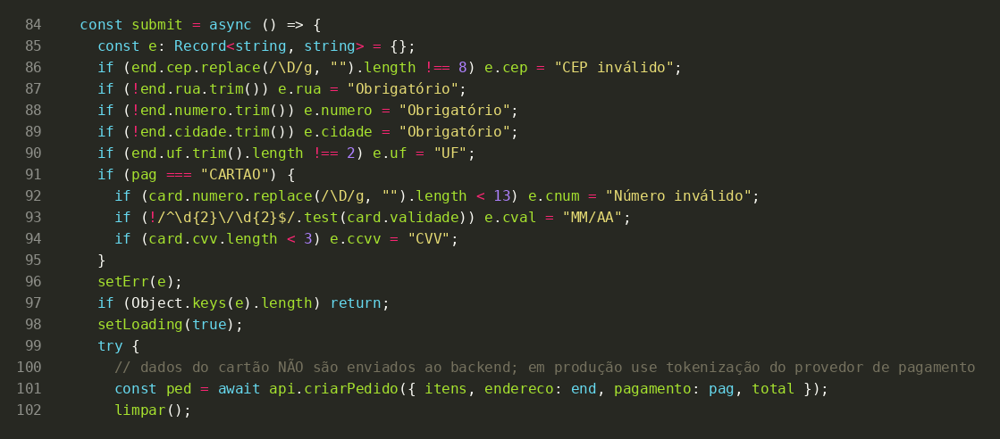

**Justificativa:** as telas misturavam apresentação com regras de negócio (baixa coesão, violação do **SRP**), a lógica era impossível de testar sem renderizar UI e duplicada (violação de **DRY**; risco de divergir do backend, que recalcula o preço). Havia ainda dependência entre telas (`OrderScreens → ProductScreens`).

**Depois** — regras em funções puras no domínio, telas só orquestram:

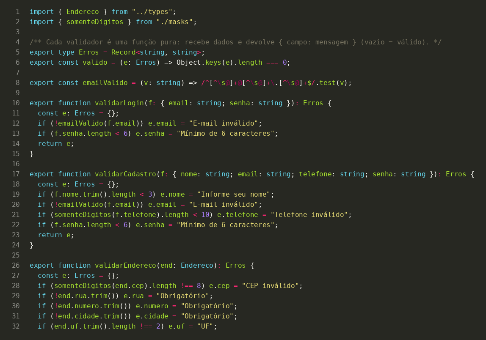

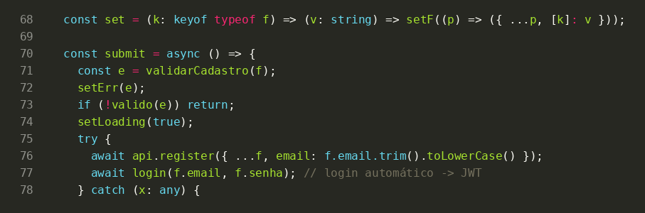

Arquivos novos: `domain/validators.ts` (validadores puros), `domain/masks.ts`, `domain/pricing.ts` (regras de preço em um só lugar), `components/NeedLogin.tsx` e `components/Stepper.tsx`. Cada módulo tem **uma razão para mudar**; as regras são testáveis sem UI.

---

## 3. Como entregar na branch
```bash
git checkout -b refactor/boas-praticas
# aplicar a refatoração (patch ou cópia dos arquivos) e:
git add -A && git commit -m "refactor: DIP na API e extração de domain"
git push -u origin refactor/boas-praticas
```
